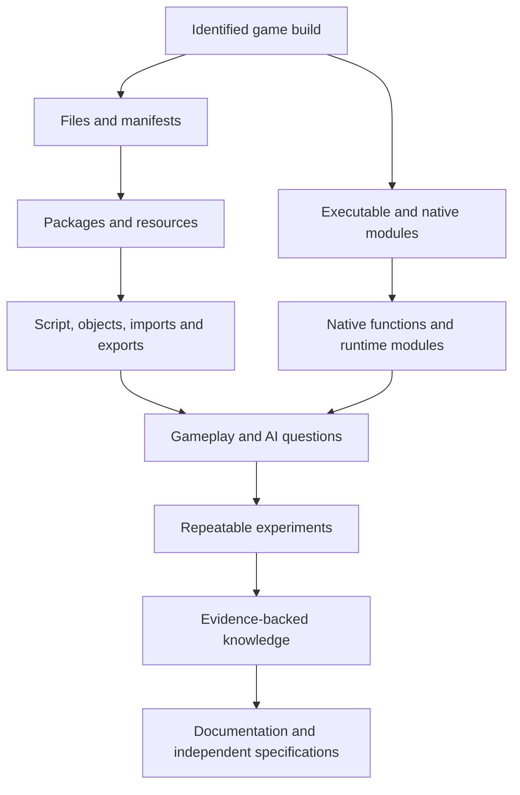

# System architecture map

This is a research map, not a claim that each listed layer has been confirmed in a particular installed build. The project will connect artifacts and observations as evidence is gathered.

## Boundaries

- **Build identity** anchors all binary addresses, package observations, and behavior results.
- **Static artifact analysis** describes what a tool parsed from a file. Record parser version and limitations.
- **Runtime observation** describes what happened in the tested scenario. It does not by itself identify the code path responsible.
- **Reconstruction** is a model derived from evidence. Keep it distinct from the original implementation.

## Candidate domains

Use these as organizing labels, not as a claim about internal implementation boundaries: build/install, file formats, UE3 packages, scripts and object metadata, gameplay abilities, AI, mission/state progression, rendering, audio, physics, UI, video, and native executable behavior.
