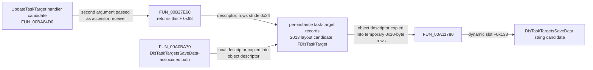

# OBJ-001 — Objective, task, Kismet, and HUD evidence cluster

This page links the currently known static evidence for the objective/task subsystem. It is a navigation summary, not a merged claim: each edge retains its evidence level and source. The exact-build static path reaches the GFx `SetObjectives` call boundary, but the specific Boyle archive graph has not been joined to it and no runtime occurrence is recorded.

## Evidence graph

```mermaid
flowchart LR
  K["Boyle archive Kismet candidates\nEXP-0169"] -. "object paths map; properties and links not retail-verified" .-> A["Retail SetTaskState export candidate"]
  A -. "specific retail node linkage unknown" .-> H["HandleTaskInstance candidate\n0x00B86840"]
  K2["Generic task-action activation\nFUN_00BA8300; donor name candidate"] -->|"exact-build: selects link named Task"| L["FUN_00BDD150\nvariable-link lookup"]
  L -->|"linked objects passed to helper"| R["FUN_00AD0DC0\nobjective/task instance resolver"]
  R -->|"returns matching task instance"| F["optional +0xF8 bit-1 filter\nCast task +0x24 to Objective; require IsActive"]
  F -->|"if filter passes; objective +0x45 == 0"| W["virtual call through action vtable +0x190"]
  W -->|"candidate vtable slot +0x190 = 0x00B86840"| H["SetTaskState handler candidate\n0x00B86840"]
  H -->|"exact-build: reads action +0xFC"| S["Setter 0x00AC17B0\nTask byte +0x5D"]
  S -->|"exact-build: code 3 iff new state 1; code 5 for any changed state"| X["FUN_00BBE6A0\nglobally gated event helper"]
  X -->|"when gate passes"| D["Objective notification dispatcher\n0x00AD4F60"]
  SH["SetTaskHidden handler candidate\n0x00B86820"] -->|"action +0xFC bit 0"| VF["FUN_00AC63C0\ntask +0x60 bit 3 updater"]
  VF -->|"if bit 3 clears and task +0x5D = 1"| X
  D -->|"case 3"| H3["FUN_00AD1080\nTask event handler"]
  H3 -->|"if bit 3 clear and parent guard passes"| TADD["FUN_00BB27C0\ntask popup event byte 0"]
  TADD -->|"if HUD mask +0x1FC & 0x4000"| Q
  D -->|"case 5; TaskStateChanged label inferred"| N["OnTaskStateChanged path\n0x00AD1320"]
  N -->|"task byte 2; guarded aggregate check"| O["FUN_00ACBC70\nall related task bytes == 2"]
  O -->|"exact-build: writes objective +0x45 = 1; dispatches code 1"| X
  D -->|"case 1; CompletedObjective label inferred"| U["FUN_00AD0E00\ncode 1 handler"]
  U -->|"exact-build guarded call"| P["FUN_00BB2500\ncompletion popup queue candidate"]
  P -->|"exact-build: append popup record"| Q["HUD popup queue +0x514"]
  Q -->|"tick + timer/open gates"| T["FUN_00BAFE70\nactive popup +0x4FC"]
  T -->|"exact-build: serializer call"| G["FUN_00B98A40\nGFx SetObjectives"]
  G -->|"observed literal/call boundary"| V["GFx movie method\nSetObjectives"]
```

Solid arrows describe direct exact-build static data/control flow. Dashed arrows show cross-source name or object mapping with unresolved retail linkage.

## Task-target record side path

This path concerns per-object task-target data, not a demonstrated edge in the Boyle archive graph or the task-completion chain above.

Exact-build offsets and package member names/types are compared with the versioned 2013 SDK layout in [EXP-0182](../../experiments/EXP-0182-task-target-layout-and-save-crosswalk.md). The `+0x68` / `0x24`-byte layout and field-name crosswalk are strongly corroborated, while the row `+0x20` bit meaning, virtual method identity, save/load lifecycle, Kismet values/links, and runtime marker behavior remain unconfirmed. The external save/load source is an incomplete reconstruction.

[EXP-0183](../../experiments/EXP-0183-boyle-update-task-target-export-census.md) identifies 25 exact-hash `DisSeqAct_UpdateTaskTarget` exports under `TheWorld.PersistentLevel.Main_Sequence.Boyle_Objectives` in `L_Boyle_Int_Script.upk`, plus 21 candidates across adjacent Boyle script packages. This narrows a potential static graph/property recovery target; no serialized properties or Kismet edges have been recovered from those exports.

[EXP-0184](../../experiments/EXP-0184-task-target-selector-to-marker-and-focus-path.md) traces selected target-row pointers into two exact-build consumers. Marker reconciliation passes selector mode 1 (two extra gates); trace-hit membership passes mode 0. The row's first pointer and selected settings pointer are stored at marker object `+0x08` and `+0x0C`; the indexed location method reads the first pointer for coordinates. Row `+0x20` bit 0 chooses between two settings pointers crosswalked to regular/optional marker settings. Constructor byte `row+0x1C` selects pointers for values 0–2; a pinned 2013 SDK names the matching enum values `Default`, `VeryClose`, and `Never`, but visible vanish behavior is unknown. The owner wrapper's slot `+0x0C` callback resolves to a no-op stub, while the unindexed update candidate at slot `+0x14` has no direct call found. Filtered archive exports contain no preset property rows. Retail Kismet values/links, runtime execution, and visible HUD behavior remain unknown.

[EXP-0185](../../experiments/EXP-0185-boyle-archive-update-task-target-crosswalk.md) matches all 24 archive `UpdateTaskTarget` names to exact-hash retail Boyle Interior exports by class/name/outer path; the retail catalog has an additional `_41` name. Its joined CSV retains archive `Task`/`Target` variable references and output destinations as archive-only leads, and stores retail UELib/UE Explorer indices separately. The archive UPK hash is unavailable, so none of these links are asserted as retail Kismet edges.

[EXP-0186](../../experiments/EXP-0186-boyle-archive-target-labels-and-variable-leads.md) adds archive `m_TargetName` values for 22 nodes and resolves their 48 linked task-variable references: 47 point to `BoyleAssassination`, while `_15` (`Lord Shaw`) points to `PendeltonsNote` under the `Boyle_Objectives` outer sequence. Retail export-name searches find the referenced task/custom-task names and `SpawnerPawn_7`; retail has two exact `SpawnerPawn_1` exports, so the actor row is ambiguous by name. A same-named `_1` in `L_Pub_FromBoyle_Script` is another separate object. These clues prioritize checks but do not establish retail property/edge values or runtime behavior.

[EXP-0187](../../experiments/EXP-0187-task-target-input-actions-and-index-census.md) audits 384 unique archive `UpdateTaskTarget` actions (430 property rows): 39 have `m_TargetIndex` values 1–3, and their three input labels are `Set`, `Clear`, `Toggle`. A linked Overseer pair has the same target label and serialized task/target variable leaf names but indices 1 and 2; duplicate Task_30 definitions make a leaf-only join ambiguous. Exact-build `FUN_00BA84D0` reads three bits at offsets consistent with `FSeqOpInputLink::bHasImpulse` and its control flow aligns with Set/Clear/Toggle behavior. Its candidate vtable is installed by the exact-build constructor crosswalked to `UDisSeqAct_UpdateTaskTarget`; the handler body name remains weaker. The action field at `+0xFC` is used as the index into the task's `+0x68` target-row array, strongly supporting the `m_TargetIndex` interpretation. Archive values are not retail Kismet evidence.

[EXP-0188](../../experiments/EXP-0188-parallel-task-marker-reconciliation-paths.md) distinguishes two exact-build reconciliation collections. `FUN_00BAD550` reconciles selector-returned task-target rows into owner `+0x524/+0x528` via constructor `FUN_00BCE750`; `FUN_00BAD960` reconciles a separate collection at `+0x530/+0x534` via `FUN_00BCE9A0` (raw allocation `0xD8` bytes). Both append objects to `+0x554/+0x558`, which `FUN_00BB00C0` traverses using virtual slot `+0x0C` with a forwarded float argument. The constructor vtables differ at that slot: one target is a `ret 4` stub, the other subtracts the forwarded argument from object fields `+0xC8/+0xD0`; field meanings remain unknown, and their common six-entry table suffix does not prove inheritance. Raw x86 establishes stale-entry cleanup in both paths: remove the pointer from the secondary list, call object vtable slot 0 with argument `1`, then remove one indexed primary entry. In the `FUN_00BAD960` path, slot 0 calls `FUN_00BCEB00` and delegates `this` to an unresolved global virtual callback.

[EXP-0189](../../experiments/EXP-0189-player-pawn-candidate-collector-and-distance-gates.md) resolves `DAT_0145F628` to the object whose vtable EXP-0021 identifies as `DishonoredPlayerPawn`. `FUN_00BAD960` calls that Pawn's slot `+0x700`, which maps to `FUN_00AB6960`; it gathers filtered entries from a linked list rooted at `Pawn+0x9D4`, follows each node's `+0x90` next pointer, and applies `FUN_00B0B780` in mode `2`. A separate source walks Pawn array `+0xAC8/+0xACC` and maps entries through `FUN_00B599B0`. Both feed the local candidates used by reconciliation, followed by `FUN_00BA6E50` numeric squared-distance gates against owner-setting fields `+0x7FC/+0x800/+0x804`. List/array element types, filter meaning, setting names, runtime visibility, and specific Kismet linkage remain unknown.

## Evidence by layer

| Layer | Current evidence | Claim status | Primary records |
| --- | --- | --- | --- |
| Kismet inventory | Retail class/package census and archive-to-retail export path candidates | Observed census; archive graph links unverified in retail | [EXP-0166](../../experiments/EXP-0166-retail-kismet-story-and-event-census.md), [EXP-0167](../../experiments/EXP-0167-brothel-storyflag-retail-node-crosswalk.md), [EXP-0168](../../experiments/EXP-0168-brothel-remote-event-endpoint-crosswalk.md), [EXP-0169](../../experiments/EXP-0169-boyle-assassination-task-state-retail-crosswalk.md) |
| Kismet → native | Exact-build generic action code selects the `Task` variable link and resolves linked task instances; four task-action table candidates share slots 93–99, while slot `+0x190` points to per-action handler candidates including `0x00B86840` | Slot pointers/fingerprint observed in exact-build PE; table/class identities and donor labels vary in confidence; specific Boyle retail node link remains unverified | [EXP-0170](../../experiments/EXP-0170-task-state-native-storage-crosswalk.md), [EXP-0177](../../experiments/EXP-0177-kismet-task-variable-to-native-dispatch.md), [EXP-0179](../../experiments/EXP-0179-task-action-vtable-family.md) |
| Task-action gates | Candidate action flags at `+0xF8`: bit 0 controls HUD mask `0x4000`, which gates seven objective/task popup callbacks; bit 1 applies an Objective cast/`IsActive` filter to task instances | Bit behavior and callback guards exact-build static; names/defaults inferred from editor source; visible popup behavior unknown | [EXP-0178](../../experiments/EXP-0178-task-action-objective-and-hud-gates.md) |
| Task flag → task-added path | Candidate SetTaskHidden handler passes action `+0xFC` bit 0 to a task updater; clearing task `+0x60` bit 3 with task byte `+0x5D == 1` can route event code 3 through a gated dispatcher to the task-popup callback, subject to parent and HUD guards | Numeric fields, masks, and code path observed in exact-build static analysis; `m_bHidden` is a layout-order candidate with no bit-specific assertion; `SetTaskHidden`, state/event meanings, and `OnTaskAdded` remain cross-source labels; runtime execution unknown | [EXP-0171](../../experiments/EXP-0171-task-state-event-dispatch.md), [EXP-0176](../../experiments/EXP-0176-objective-task-popup-event-codes.md), [EXP-0179](../../experiments/EXP-0179-task-action-vtable-family.md), [EXP-0180](../../experiments/EXP-0180-task-visibility-flag-event-path.md), [EXP-0182](../../experiments/EXP-0182-task-target-layout-and-save-crosswalk.md) |
| Task-target records | Handler candidate `00BA84D0` uses a per-object `+0x68` descriptor with `0x24`-byte rows; exact-build constructor installs its candidate table; selector output feeds marker-like object construction and traced-hit membership; archive census adds `m_TargetIndex` and Set/Clear/Toggle leads | Numeric offsets, row-pointer flow, and table ownership are strongly corroborated; handler body name remains weaker; archive labels/links stay archive-only and leaf-only variable joins remain ambiguous; retail row values, save/load lifecycle, and runtime marker behavior remain unknown | [EXP-0179](../../experiments/EXP-0179-task-action-vtable-family.md), [EXP-0181](../../experiments/EXP-0181-task-target-per-instance-array-and-archive-paths.md), [EXP-0182](../../experiments/EXP-0182-task-target-layout-and-save-crosswalk.md), [EXP-0183](../../experiments/EXP-0183-boyle-update-task-target-export-census.md), [EXP-0184](../../experiments/EXP-0184-task-target-selector-to-marker-and-focus-path.md), [EXP-0185](../../experiments/EXP-0185-boyle-archive-update-task-target-crosswalk.md), [EXP-0186](../../experiments/EXP-0186-boyle-archive-target-labels-and-variable-leads.md), [EXP-0187](../../experiments/EXP-0187-task-target-input-actions-and-index-census.md) |
| Task storage | Action byte `+0xFC` enters setter; task byte `+0x5D` is read/written | Exact-build static code; field names corroborated by a 2013 retail SDK dump not SHA-bound to target | [EXP-0170](../../experiments/EXP-0170-task-state-native-storage-crosswalk.md), [EXP-0173](../../experiments/EXP-0173-task-state-field-layout-crosscheck.md) |
| Notification dispatch | Numeric codes 0–5 route to six handlers; listener and virtual-call loops | Numeric switch observed; `DOCNET_*` labels inferred at varying matcher quality | [EXP-0171](../../experiments/EXP-0171-task-state-event-dispatch.md), [EXP-0172](../../experiments/EXP-0172-objective-notify-enum-crosswalk.md) |
| Objective aggregation | Task byte 2 can trigger an all-related-tasks check, objective byte `+0x45 = 1`; a separate active test returns true when `+0x45 == 0` | Exact-build static paths; `DOS_Active` / `DOS_Completed` labels remain inferred from separate SDK enum/layout | [EXP-0173](../../experiments/EXP-0173-task-state-field-layout-crosscheck.md), [EXP-0174](../../experiments/EXP-0174-task-to-objective-completion-hud-path.md), [EXP-0178](../../experiments/EXP-0178-task-action-objective-and-hud-gates.md) |
| HUD queue / GFx | Seven callbacks gate on HUD mask `0x4000`; task event bytes 2/3 have direct unnamed producers; completion candidate queues a popup record, HUD tick promotes it, serializer calls `SetObjectives` | Exact-build static call path and numeric writes; callback names/enum meanings are candidates; visible rendering is unknown | [EXP-0174](../../experiments/EXP-0174-task-to-objective-completion-hud-path.md), [EXP-0175](../../experiments/EXP-0175-objective-popup-queue-to-gfx.md), [EXP-0176](../../experiments/EXP-0176-objective-task-popup-event-codes.md), [EXP-0178](../../experiments/EXP-0178-task-action-objective-and-hud-gates.md) |

## Numeric domains — keep separate

| Domain | Value | Current interpretation | Evidence limit |
| --- | ---: | --- | --- |
| Task state (`m_TaskState`, task `+0x5D`) | 2 | Candidate `DTS_Completed` | Editor enum ordinal plus external retail offset agreement; exact-build enum metadata not independently recovered |
| Objective state (`m_ObjectiveState`, objective `+0x45`) | 1 | Candidate `DOS_Completed` | External 2013 layout/enum corroboration, not target-EXE-hash-bound |
| Objective notification argument | 1 | Candidate `DOCNET_CompletedObjective` | Exact switch observed; name comes from SDK/export crosswalk |
| Objective popup `m_Event` | 0 / 1 / 2 / 3 | Candidate ObjectiveAdded / task-update container / ObjectiveCompleted / ObjectiveFailed | Numeric writes/filters are exact-build; labels inferred from candidate symbols |
| Task popup `m_Event` | 0 / 1 / 2 / 3 | Candidate TaskAdded / TaskUpdated / TaskCompleted / TaskFailed | All four bytes have exact-build producer/callback evidence; event enum not recovered, and producers for 2/3 are unnamed |

Matching numbers across these fields do not establish shared meaning.

See [EXP-0176](../../experiments/EXP-0176-objective-task-popup-event-codes.md) for the callback-by-callback event-byte map and donor matcher quality.

## Open questions

1. Recover one retail Boyle `DisSeqAct_SetTaskState` node's serialized property values and Kismet input/output/variable links from exact-hash package bytes.
2. Independently corroborate the inferred UpdateCustomTask table at RVA `0x00D55430` and determine whether the shared slots identify the same class family; the donor's `0x00D59C60` association is contradicted by target bytes.
3. Determine whether a retail mission node sets the candidate SetTaskHidden action bit and task flag values needed for the EXP-0180 event-3 path; current Boyle crosswalks do not establish those properties.
4. Prove that a selected retail Boyle node's task object reaches the exact-build handler and the same objective aggregation path; current export path matches do not supply that edge.
5. Recover exact popup-event enum names and GFx `SetObjectives` consumer behavior, then establish runtime execution on the registered build with an approved recorded baseline.
6. Reconcile candidate symbol-size differences against exact-build instruction boundaries before promoting donor names. For example, `FUN_00BB2500` is 346 bytes in the local target index versus 351 in the donor 2013 export.

## Reproduction anchors

- Target build and EXE hash: [BUILD-STEAM-10256413](../../research/builds/BUILD-STEAM-10256413/build.md)
- Current project status: [research status](../research-status.md)
- Function evidence rules: [L0–L4 model](../methodology/function-evidence-model.md)
- Experiment source of truth: the EXP records linked in the table above, including [EXP-0179](../../experiments/EXP-0179-task-action-vtable-family.md)
