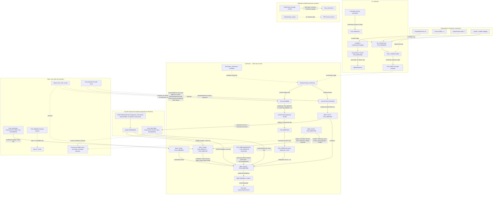

# Blink activation evidence graph

Build `10256413`. Edges are labeled by evidence status. Do not merge parallel graphs until a concrete join exists.

## Edge checklist

| ID | Edge | Status | Primary EXP |
| --- | --- | --- | --- |
| E1 | Scaleform focus → `OnSelectionChanged` int | confirmed correlation | 0019 |
| E2 | PowerWheel `+0x1F0` → item-info refresh | confirmed | 0021 |
| E3 | `Dis_SelectPower` → selection/state manager | confirmed | 0021, 0027 |
| E4 | Shortcut Use → activation | open (no static edge) | 0026, 0027 |
| E5 | UsePower `+0x134` → Blink `+0x1AC` | confirmed static | 0028 |
| E5a | UsePower `+0x184` → context-held component `+0x168` | confirmed static conditional; dynamic component class at runtime unknown | 0048 |
| E5b | Blink/Transversal `+0x168` → `FUN_00BFC020` → guarded `FUN_00BFAAA0` → component `+0x1AC` → conditional Blink move-mode entry | confirmed static conditional; success/runtime occurrence unknown | 0044, 0048 |
| E6 | Blink move mode → position write | confirmed gated | 0024, 0030 |
| E6a | Blink base `+0x1B0` target writer → fields consumed by Blink base `+0x1AC` | confirmed same receiver fields; Transversal subclass wraps both with same `this` | 0043, 0030, 0044 |
| E6b | Blink update `+0x13C` in Warmup → virtual `+0x1B0` target refresh | confirmed static same-receiver dispatch; engine tick callsite unknown (generic slot candidates remain unresolved; two audited without a Blink join) | 0045, 0046, 0051 |
| E7 | Input/event → UsePower `+0x134/+0x184` or Blink `+0x340` | open; dynamic caller of both UsePower methods not identified; +0x13C candidate audit adds no Blink/input edge | 0028–0040, 0042, 0047–0049, 0051 |
| E8 | `FUN_00C0CA70` → UsePower instance | open / weakened; argument counts differ from known target signatures, but extra arguments may be ignored; dynamic receiver class remains unknown | 0029, 0032, 0049 |
| E9 | Pawn manager → known UsePower targets | rejected (ABI); manager path itself is real | 0035, 0037 |
| E10 | Keyed registry → Blink | open / unjoined | 0031, 0036 |

## Next discriminating checks

1. The target writer/consumer join and Blink Warmup `+0x13C` → virtual `+0x1B0` dispatch are confirmed (EXP-0043/0045); package `TickGroup` supports, but does not prove, an engine tick interpretation. Corrected EXP-0046 finds 79 generic `+0x13C` load-call patterns; EXP-0051 traces two candidates to generic dispatch paths without establishing Blink receivers. Find a scheduler call through dataflow that proves the receiver's class/vptr. EXP-0048 adds a conditional static UsePower `+0x184` → component `+0x168` route; EXP-0049 records an argument-count discrepancy at `FUN_00C0CA70`, but extra arguments may be ignored, so the receiver identity remains open. Trace tick registration, context creation, and the actual caller of `+0x184` independently; do not join them based on nearby code or shared offsets.
2. Runtime vptr at UsePower/Blink call sites after a clean process attach (`EXP-0016`).
3. Do not prioritize E9 as Blink activation until a stack-compatible receiver appears; keep E8 on a separate open graph.
4. Keep Swarm producer graph (`FUN_00C44E30` → `FUN_00BFAFD0`) out of Blink activation unless a new join appears.
