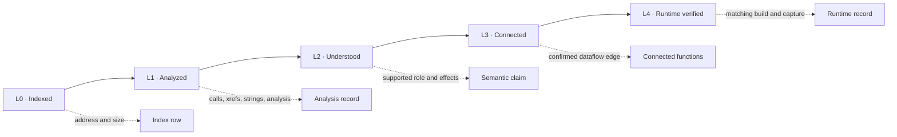

# Visual research progress dashboard

**Snapshot: 2026-10-27 · Target build: Steam x86 `10256413`**

This dashboard summarizes research by direction. It does not combine unlike work into a project-wide completion score. The labels below describe the maturity of the published evidence and are qualitative; measured counts retain their own denominator and limitations.

> **Evidence boundary:** inventory, successful parsing, static analysis, semantic claims, independent review, and runtime verification are separate outcomes. A completed inventory does not mean that its contents are understood. EXP records and their cited artifacts remain authoritative; this page is a navigation and status summary.

## Executive summary

| Research direction | Current status | Established evidence | Main open question | Details |
| --- | --- | --- | --- | --- |
| Build and installation baseline | Established for the recorded snapshot | Steam build identity recorded; 13,623 manifest paths; all 904 installed UPKs reconciled | The install contains a modded start-menu package; prior manifest path-level delta is unavailable | [Build and installation](progress/build-and-installation.md) |
| Packages and file formats | Broad static coverage | 904 UPKs cataloged; 4,056 non-empty localized AKPK files parsed; selected object and format studies | Semantic payload coverage, unsupported/unknown objects, and runtime resource selection | [Packages and formats](progress/packages-and-formats.md) |
| Config and path analysis | Candidate evidence established | EXP-0114 records path-shaped declarations and filesystem candidates | Which roots and declarations the game actually resolves at runtime | [Config and path analysis](progress/packages-and-formats.md#config-and-path-analysis) |
| Blink and gameplay | Active static reconstruction | Several conditional static activation edges are confirmed; competing/rejected paths are kept separate | Dynamic caller/scheduler bridge and runtime behavior | [Gameplay and Blink](progress/gameplay-and-blink.md) |
| Native code | Large index; selective review | 72,437 indexed functions; 47 manual body reviews; 54 functions with portable analysis records | High-value ownership/dataflow links and scalable semantic review | [Native code](progress/native-code.md) |
| Audio and media | Broad corpus parsing | PCK/AKPK, HIRC, WEM, and Bink cohorts have substantial parser/decode coverage | Event meaning, perceptual correctness, playback selection, and runtime behavior | [Audio and media](progress/audio-and-media.md) |
| Tooling and automation | Reproducibility improving | Repository validators, schemas, CI, and a portable function coverage export | Extend provenance and checks to more generated catalogs and analysis versions | [Tooling and automation](progress/tooling-and-automation.md) |
| Collaboration and review | Ready for scoped contributions | Onboarding, small tasks, templates, evidence policy, and independent-review workflow | More independent reproductions and contributor participation | [Collaboration and review](progress/collaboration-and-review.md) |

## Measured corpus snapshot

| Measure | Current value | What the number means |
| --- | ---: | --- |
| Published experiments | 155 | EXP-0001–0155 are present in the repository; count does not measure completeness |
| Registered executable | Steam x86 build `10256413` | SHA-256 is recorded in the [build record](../research/builds/BUILD-STEAM-10256413/build.md); executable is not distributed |
| Install manifest | 13,623 paths | Snapshot inventory, not proof that every file is unmodified or understood |
| Installed UPKs | 904 / 904 | Paths, sizes, and hashes reconcile with the recorded package manifest |
| Internal functions indexed | 72,437 / 72,437 | Exact-build index denominator; indexing is L0, not semantic analysis |
| Manually reviewed function bodies | 47 / 72,437 | Cumulative EXP-0155 static body-review overlay; runtime review is separate |
| Functions with portable analysis records | 54 / 72,437 | 47 overlay rows plus seven curated records in the [coverage export](../research/executable/evidence/function-triage/function-coverage-EXP-0155.json) |
| Confirmed portable semantic claims | 4 | Claim status in the curated registry; not a count of all potentially known local DB rows |
| Bink files fully decoded | 76 / 76 | FFmpeg accepted video and reported audio streams to a null sink; perceptual quality/runtime selection remain open |
| Non-empty localized AKPK files parsed | 4,056 / 4,056 | Table/format parsing coverage with scoped cross-checks; not proof of bank semantics |
| Runtime-verified function records | 0 published | No current repository record satisfies the L4 runtime gate |

See the [full coverage snapshot](coverage.md) and [published evidence index](published-evidence.md) for denominators and caveats.

## Next milestone priorities

These are ordered research priorities, not completion percentages or promises of runtime evidence. Runtime work must use the registered build, a recorded baseline, and a dedicated experiment record.

| Horizon | Priority | Exit evidence | Workstream |
| --- | --- | --- | --- |
| Immediate | Correct decompilation cache invalidation | Cache identity includes function address, build ID and executable SHA-256, Ghidra version, all output-affecting analysis options, and analysis-project revision; tests show each change invalidates the entry | [Tooling](progress/tooling-and-automation.md) |
| Immediate | Enforce build identity for runtime evidence | Runtime importer rejects a record whose build SHA does not match the indexed function; positive and negative build-identity cases are covered | [Tooling](progress/tooling-and-automation.md) |
| Immediate | Establish one narrow runtime-confirmed gameplay result | A reproducible experiment records the matching build, clean baseline/capture, conditions, and observed behavior; no runtime claim is inferred from static edges | [Gameplay and Blink](progress/gameplay-and-blink.md) |
| Near term | Review high-value native clusters | Body reviews are selected by connectivity and unresolved ownership/dataflow gaps, with each role scoped to its own evidence | [Native code](progress/native-code.md) |
| Near term | Extend provenance to generated catalogs | Manifests record source hashes, build, tool/version/options, row counts, and reproduction command; CI checks selected portable outputs | [Tooling](progress/tooling-and-automation.md) |
| Near term | Grow independent review | A second researcher reproduces or challenges selected high-value results; review records preserve disagreements and scope | [Collaboration](progress/collaboration-and-review.md) |
| Later | Expand runtime instrumentation | Traces are attached only to documented experiments and matching-build baselines; static candidate edges remain separate | [Gameplay and Blink](progress/gameplay-and-blink.md) |
| Later | Connect native clusters to gameplay models | At least one additional ownership/dataflow chain is supported by source-backed edges and linked into the relevant subsystem dossier | [Native code](progress/native-code.md) |

The main implementation dependencies are visible: cache and runtime identity integrity support trustworthy analysis; a bounded runtime result then tests one gameplay bridge; targeted cluster reviews and provenance make subsequent expansion more efficient.

## Function evidence gates

The repository's L0–L4 levels describe function evidence. **L3 means a supported dataflow connection; L4 means runtime verification.** Independent reproduction/review is a separate review process, not L3.

Current portable function coverage is [exported per function](../research/executable/evidence/function-triage/function-coverage-EXP-0155.csv), with input hashes and scope in its [manifest](../research/executable/evidence/function-triage/function-coverage-EXP-0155.json). L3/L4 are explicitly not exported there; they are not silently counted as zero from an unavailable SQLite database.

## How to read status

- “Established” describes a bounded artifact or inventory result, not full system understanding.
- Status labels are qualitative judgments grounded in the linked EXPs; percentages are omitted where there is no defensible denominator or completion criterion.
- Static candidates, confirmed semantic claims, independent reviews, and runtime observations must retain their distinct claim labels.
- Each direction page links to the next useful task or open question. Contributors can also start from [small contributor tasks](contributor-tasks.md).
