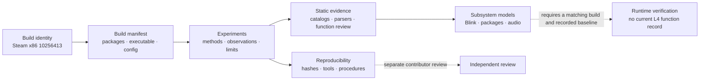

# Visual research progress dashboard

**Snapshot: 2026-10-27 · Reference build: Steam x86 `10256413`**

This is a reverse-engineering research corpus, not a feature roadmap for a conventional software product. Progress is measured by direction and denominator. Inventory, parsing, static interpretation, independent review, and runtime confirmation are different outcomes; there is no single project completion percentage.

## Direction overview

| Direction | Status | Established evidence | Main open question | Details |
| --- | --- | --- | --- | --- |
| Build and installation | **Established** | Exact executable identity and 13,623-path snapshot; all 904 UPKs reconcile | The installation contains a documented mod; the previous manifest's path-level delta is unavailable | [Build record](../research/builds/BUILD-STEAM-10256413/build.md) |
| Packages and formats | **Strong** | UPK object catalogs and scoped UELib/format studies; 4,056 non-empty AKPK files parsed | Payload meaning, unknown objects, and runtime selection | [Coverage](coverage.md), [baseline findings](findings/baseline.md) |
| Config and paths | **Active** | EXP-0114 records filesystem candidates under tested roots | Which root/load order the game actually uses | [EXP-0114](../experiments/EXP-0114-config-path-candidate-audit.md), [EXP-0136](../experiments/EXP-0136-configured-map-and-package-name-joins.md) |
| Blink and gameplay | **Active** | Conditional static activation edges are documented; alternatives remain separate | Dynamic caller/scheduler bridge and runtime behavior | [Activation graph](gameplay/blink/activation-graph.md), [Blink findings](findings/blink-native.md) |
| Native code | **Early-to-mid** | 72,437 indexed functions; 49 cumulative manual body reviews | Ownership/dataflow gaps and selective semantic review | [Function evidence model](methodology/function-evidence-model.md), [triage catalog](../research/executable/evidence/function-triage/README.md) |
| Audio and media | **Strong** | PCK/AKPK, HIRC, WEM, and Bink parser/decode cohorts | Event meaning, playback selection, and runtime semantics | [Coverage](coverage.md) |
| Tooling and automation | **Strong** | Validators, experiment schemas, CI, and local research tooling | Cache identity and portable provenance across more outputs | [Tooling overview](tooling/mcp.md), [audit](reviews/AUDIT-2026-10-27-documentation-and-onboarding.md) |
| Collaboration and review | **Active** | Contributor guide and review workflow | Independent reproductions and broader participation | [Contributing](../CONTRIBUTING.md), [review workflow](methodology/workflow.md) |

## Visual overview

This is a conceptual research workflow, not a claim that every result has passed through every stage.

## Measured snapshot

| Measure | Value | Scope |
| --- | ---: | --- |
| Published experiments | 159 | EXP-0001–0159; corpus size does not measure completeness |
| Registered executable | Steam x86 build `10256413` | SHA-256 `66443F3D68A6C658B0ED943260C3EB2F4CC9E3400D5809A94D6EC41EB725E17E` |
| Install manifest | 13,623 paths | Recorded local snapshot; not every path was rehashed in the same experiment |
| Installed UPKs | 904 / 904 | Path/size/hash matched to package manifest |
| Internal functions indexed | 72,437 / 72,437 | Indexing is L0, not semantic review |
| Manual function body reviews | 49 / 72,437 | Static body review through EXP-0159 |
| Derived ledger snapshot | L0=72,382; L1=51; L2=4; L3=0; L4=0 | EXP-0156 sync snapshot; generated local DB view, not an independently portable export |
| Non-empty localized AKPK | 4,056 / 4,056 | Three of 4,059 inventoried files were empty placeholders |
| PCK WEM decode | 1,908 / 1,908 | Decoder acceptance; perceptual correctness and in-game selection remain open |
| Bink full-stream decode | 76 / 76 | Decoded to null sink; quality and runtime selection remain open |
| Runtime stage | 0 clean-baseline behavior experiments | Runtime verification has not been established |

See the [coverage snapshot](coverage.md) for the full denominator and caveat list. The local L0–L4 ledger counts are recorded from a derived sync snapshot; they should not be confused with a published per-function export.

## Next milestone priorities

| Horizon | Priority | Exit evidence |
| --- | --- | --- |
| Immediate | Complete decompilation-cache invalidation | Key includes function address, build ID/SHA, Ghidra version, analysis options, and project-analysis revision; changing any input invalidates the entry |
| Immediate | Enforce build SHA for runtime records | Import rejects a runtime record whose executable hash differs from the indexed build |
| Immediate | Produce one narrow runtime-confirmed gameplay record | Matching build, documented baseline/capture, controlled conditions, and observed behavior in a dedicated EXP |
| Near term | Review high-value native clusters | Body reviews resolve specific ownership/dataflow questions rather than proceeding by address order |
| Near term | Add provenance manifests to generated catalogs | Source hashes, build, tool/version/options, row counts, and reproduction command are recorded |
| Near term | Expand independent review | A second researcher reproduces or challenges selected findings; disagreements remain traceable |
| Later | Extend runtime instrumentation and gameplay links | New runtime traces are build-bound and attached to specific experiment questions |

Runtime experiments require a recorded baseline and a specific research procedure. Static candidates are not promoted to runtime facts.

## How to read status

The shared qualitative labels are **Established**, **Strong**, **Active**, **Early-to-mid**, **Exploratory**, and **Blocked**. They summarize evidence maturity, not a percentage. A large inventory count does not imply that its contents are understood; open questions and contradictions remain visible by design.
