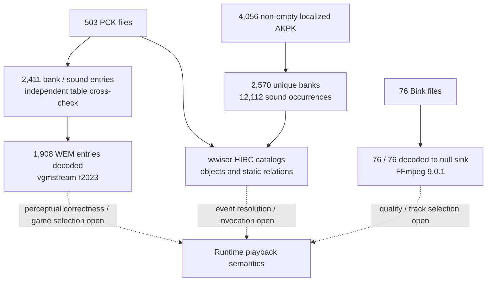

# Audio and media

**Status: Strong.** Corpus parsing and selected decode coverage are extensive; runtime meaning remains open. Successful parsing or decoder acceptance is not the same as correct playback or a proven game-side dependency.

## Visual coverage map

The diagram separates container/table parsing, payload decoding, HIRC relations, and runtime behavior. It does not claim the three asset groups converge on the same playback path.

### Evidence breakdown

| Workstream | Measured evidence | Interpretation boundary |
| --- | --- | --- |
| PCK tables | 503/503 PCK files; 2,411 bank/sound rows matched by an independent table parser | Parser interpretation is informed by the pinned QuickBMS layout; no vendor specification |
| PCK WEM decode | 1,908/1,908 WEM entries decoded | Decoder acceptance does not establish perceptual correctness or in-game selection |
| PCK HIRC | 503 PCK banks plus `Init.bnk` parsed; static HIRC relation and target-ID audits recorded | ID matches remain candidates unless semantics or runtime use are independently supported |
| Localized AKPK | 4,056 non-empty containers parsed; 2,570 unique bank payloads and 12,112 sound-entry occurrences | Static container/HIRC/media joins do not establish playback |
| Bink | 76/76 files decoded to a null sink | No audiovisual quality or game track-selection claim |

These measures overlap and have different denominators; they describe the research mix rather than a percentage allocation.

## Measured coverage

- 503 PCK files and 2,411 embedded bank/sound rows were cataloged; a separate Python parser matched the QuickBMS catalog's paths, offsets, and sizes (EXP-0119/0120).
- All 1,908 cataloged PCK WEM entries decoded with vgmstream r2023. Perceptual correctness and runtime selection were not tested by this decode pass.
- Wwise analysis parses 503 PCK banks plus standalone `Init.bnk`, and records HIRC objects and static relations. Container child paths and unresolved target IDs remain subject to the limits in EXP-0077–0081/0112.
- Localized AKPK: all 4,056 non-empty containers parsed, yielding 2,570 unique bank payloads and 12,112 sound-entry occurrences; HIRC relations and media-ID joins are static evidence (EXP-0130–0135).
- All 76 manifest-hash-verified Bink files decoded through video and reported audio streams to a null sink with FFmpeg 9.0.1 (EXP-0118). This tests decoder acceptance, not audiovisual quality or game track choice.

## Open questions

- Which event/action path is selected by the game at runtime, including cross-bank target resolution?
- Which media payload corresponds to each played event under a reproducible game state?
- Are unmatched IDs semantically meaningful references or numeric coincidences?
- Do the parser-derived IDs and paths generalize beyond the tested corpus and parser versions?

## Next work

Choose one event-to-media path and seek independent structural evidence plus a controlled playback observation. Record exact source hashes and distinguish parser candidates from runtime-confirmed selection.

## Sources

[Coverage snapshot](../coverage.md) · [EXP-0118](../../experiments/EXP-0118-bink-full-stream-decode-census.md) · [EXP-0119](../../experiments/EXP-0119-wwise-wem-full-decode-census.md) · [EXP-0120](../../experiments/EXP-0120-wwise-pck-python-table-crosscheck.md) · [EXP-0134](../../experiments/EXP-0134-quickbms-localized-akpk-crosscheck.md)
