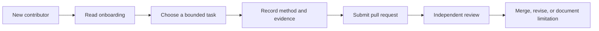

# Collaboration and review

**Status: Active.** The contributor path is documented; independent reproduction is still scaling. Public documentation lowers the entry barrier but does not substitute for a second person reproducing a result.

## Contributor path

The diagram describes the documented workflow; it does not imply that every result has already received an independent reproduction.

## Available to contributors

- [Small contributor tasks](../contributor-tasks.md) offer bounded work.
- [Onboarding](../onboarding.md), [playbook](../contributor-playbook.md), and [CONTRIBUTING](../../CONTRIBUTING.md) explain project structure and workflow.
- Issue and pull-request templates capture research questions and change context.
- Evidence, claim, and function-triage policies define how to preserve uncertainty and avoid promoting tool candidates to facts.
- Worked examples and a review template show how to record independent checks.

## Participation boundaries

The project does not distribute game binaries or extracted content, and a contributor may need a matching local copy for game-dependent work. Documentation, schema, validator, synthetic-fixture, and provenance work can be done without game data. The project notice currently says a project-wide open-source license has not been selected; contributors should review [LICENSE-NOTICE](../../LICENSE-NOTICE.md) before substantial code contributions.

## Next improvement

Prioritize small issues with explicit question, prerequisites, expected artifact, and acceptance evidence. Encourage independent reproduction of high-value findings and record disagreements without overwriting the original EXP evidence.

## Sources

[Contributor tasks](../contributor-tasks.md) · [Onboarding](../onboarding.md) · [Playbook](../contributor-playbook.md) · [Evidence policy](../methodology/evidence.md) · [Independent review template](../../templates/review.md)
