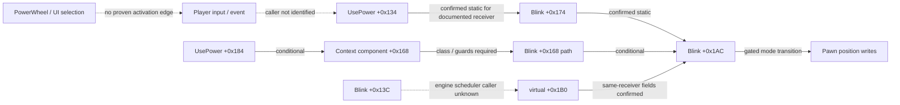

# Gameplay and Blink reverse engineering

**Status: active static reconstruction; runtime bridge incomplete.** The evidence supports several build-specific conditional edges. It does not yet connect player input to the activation path end to end in runtime behavior.

## Current model

### Visual map

Solid arrows represent the cited static relationships; dashed arrows mark unresolved bridges. The graph is intentionally narrower than a complete gameplay execution trace. See the [full activation graph](../gameplay/blink/activation-graph.md) for statuses, conditions, and rejected paths.

The [Blink activation graph](../gameplay/blink/activation-graph.md) keeps UI selection, `UsePower`, Blink movement, the Transversal subclass, open callers, and rejected alternatives in separate evidence groups. For example, `UsePower +0x134` to Blink `+0x1AC` is statically confirmed for the documented receiver conditions (EXP-0028); some `+0x184` component paths are conditional (EXP-0048). The graph does not collapse PowerWheel item `24`, UI enum `2`, active-array index `0`, or `_iPower` into one identifier.

The graph currently labels E1–E3, E5–E6 and E5a–E5b as confirmed or conditionally confirmed; E4/E7/E8/E10 remain open, and E9 is rejected as the UsePower activation route. See the graph's edge table for exact claim wording and cited EXPs.

## Main unknowns

- Which input/event path dynamically reaches `UsePower +0x134`, `+0x184`, or Blink `+0x340`?
- Which scheduler invokes the relevant Blink/Transversal update path with the expected receiver?
- Which runtime component instance satisfies the static conditional branches?
- Under what controlled baseline does the move-mode transition occur in game?

## Next discriminating work

Work these as separate joins: trace input-to-caller, establish scheduler receiver identity, then record one narrow runtime-confirmed behavior under the matching build and a clean, documented baseline. Keep its capture and conditions reproducible. Do not merge the rejected Pawn-manager ABI path or open keyed-registry hypothesis into the activation graph without new discriminating evidence.

## Sources

[Activation graph](../gameplay/blink/activation-graph.md) · [EXP-0028](../../experiments/EXP-0028-item-context-inheritance.md) · [EXP-0048](../../experiments/EXP-0048-usepower-component-slot168.md) · [Research backlog](../backlog.md)
