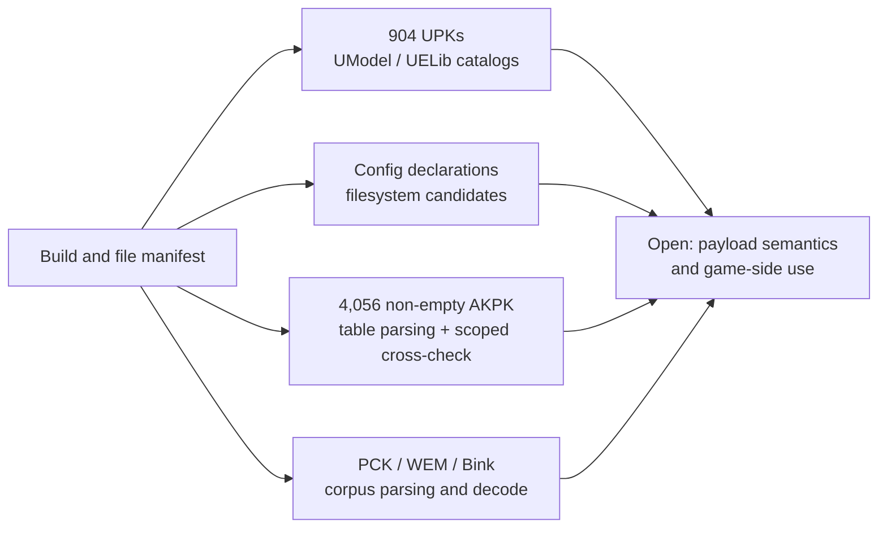

# Packages and file formats

**Status: Strong.** Coverage is broad but static and format-specific. Counts describe inventories, parser passes, or selected validations; none is a universal measure of semantic understanding.

## Visual map

The common build node indicates scope and provenance. The paths do not imply that these formats share runtime dependencies.

### Evidence breakdown

| Workstream | Measured evidence | Remaining limit |
| --- | --- | --- |
| File and package inventory | 904/904 UPKs matched by path, size, and SHA-256 | The local install contains a documented mod; matching this manifest does not prove all files are stock |
| Object/export relations | 2,885,414 UPK export rows; UELib catalogs package-local relations | Cataloged indices and parsed properties do not establish full object or bytecode semantics |
| Config/path candidates | 63 path-shaped declarations from 76 config directives; candidate matches recorded | Runtime config resolution and effective load order remain unknown |
| Container and media formats | 4,056/4,056 non-empty localized AKPK containers parsed; PCK and Bink work is separately scoped | Successful parsing/decoding does not prove game-side load or use |
| Selected texture/cache formats | Exact output comparisons exist for selected object/cache cohorts | Samples do not establish complete class or format coverage |

The rows use different populations and overlap in places, so they are not shares of a common total and should not be represented as a pie chart.

## Unreal packages

- 904/904 installed UPKs have package metadata and export catalogs; the census reports 2,885,414 exports. Seventeen packages contain name-fixing warnings; no package-open errors were reported (EXP-0052/0053).
- UELib studies cover package import/export relations and selected object/property cohorts. They do not establish complete bytecode recovery or semantics for all exports. Some DLC packages contain large numbers of `UnknownObject` wrappers; see [coverage](../coverage.md) and EXP-0062/0069/0070/0088.
- The seven-class real-export sample wrote 33 files from seven selected objects; this is not all-package export coverage (EXP-0083/0084).

## Config and path analysis

EXP-0114 records 63 syntactic path candidates from 76 config directives, ten `BasedOn` matches to existing Engine INIs under the tested roots, and four localization directory matches. Subsequent analysis found that the tested `BasedOn` candidates normalize to the same targets under both `game_root` and `engine_root`. These are **observed filesystem matches**, not proof of the engine's runtime resolution base or effective load order.

EXP-0136 separately catalogs 448 map/package-shaped references against the 904-UPK manifest. Exact basename matches and `_SF` candidates remain syntactic candidates; package resolution and consumption are unverified.

**Open question:** design a discriminating observation that distinguishes competing `BasedOn` resolution models, then test one narrow config path against a recorded baseline.

## Selected non-UPK formats

- Localized AKPK: 4,056/4,056 non-empty containers parsed; the EXP-0134 table cross-check matches QuickBMS paths, offsets, and sizes. Three of 4,059 inventoried files are empty placeholders.
- Bink: 76/76 streams decoded to a null sink by FFmpeg (EXP-0118); decoder acceptance does not establish perceptual correctness or game selection.
- TFC and selected texture/lightmap/shadowmap/flipbook cohorts have scoped parser and pixel checks, while several tail fields, classes, and generalization questions remain open (EXP-0090–0105).
- AKMAP: 2,871 candidate strings and 22,905 tested candidate tail fields were cataloged; record boundaries, field meanings, and runtime selection remain unknown (EXP-0115–0117).

## Highest-value next work

Prioritize unresolved layouts or references that connect multiple known artifacts. Preserve parser version, input hashes, denominator, and whether a check is independent of the parser that produced the candidate interpretation.

## Sources

[Coverage snapshot](../coverage.md) · [Build and installation](build-and-installation.md) · [EXP-0052](../../experiments/EXP-0052-installed-dlc-package-inventory.md) · [EXP-0053](../../experiments/EXP-0053-all-install-upk-object-catalog.md) · [EXP-0114](../../experiments/EXP-0114-config-path-candidate-audit.md) · [EXP-0134](../../experiments/EXP-0134-quickbms-localized-akpk-crosscheck.md)
