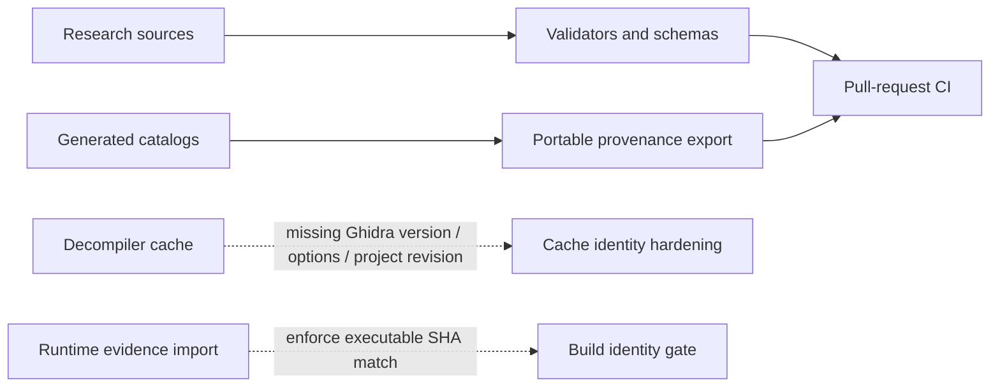

# Tooling and automation

**Status: Strong.** Repository validation is established and provenance support is growing. Tool presence is not evidence that every output is correct; generated artifacts need source, version, options, and scope.

## Visual track

The top row is in use; the two dashed rows are planned improvements, not completed safeguards.

## Available

- Repository and experiment validators check required files, local Markdown references, and experiment records.
- JSON Schemas and unit tests cover machine-readable research records and selected tooling.
- GitHub Actions runs repository validation and tests for pull requests.
- The portable function coverage exporter verifies build identity, source hashes, schemas, row counts, and exact function-address reconciliation without reading the local executable, Ghidra database, or SQLite mirror. CI runs `python tools/export_function_coverage.py --check`.
- The curated function claim registry is a committed input to the database sync and coverage export rather than data embedded in importer code.

## Remaining limitations

- Exact function re-indexing still depends on the registered executable and analysis data; the portable export republishes existing committed index evidence rather than rebuilding it.
- The derived SQLite database remains local. L3/L4 are not represented in the portable function export.
- Other generated catalogs do not yet all have a common provenance manifest with source hashes, tool/version/options, and output row counts.
- The headless decompilation cache audit identified missing invalidation inputs for Ghidra version, analysis options, and project-analysis revision; see [function evidence model](../methodology/function-evidence-model.md).

## Next work

The immediate gates are the [decompilation cache identity](../reviews/AUDIT-2026-10-27-documentation-and-onboarding.md) and runtime build matching: include function address, build ID/SHA, Ghidra version, analysis options, and project-analysis revision in cache identity; reject runtime evidence whose SHA does not match the indexed build. Add positive and negative cases for each identity component. Then adopt portable provenance manifests for new generated catalogs and migrate high-value existing outputs.

## Sources

[Published evidence](../published-evidence.md) · [Function export guide](../../research/executable/evidence/function-triage/README.md) · [Audit report](../reviews/AUDIT-2026-10-27-documentation-and-onboarding.md) · [Quality workflow](../../.github/workflows/quality.yml)
